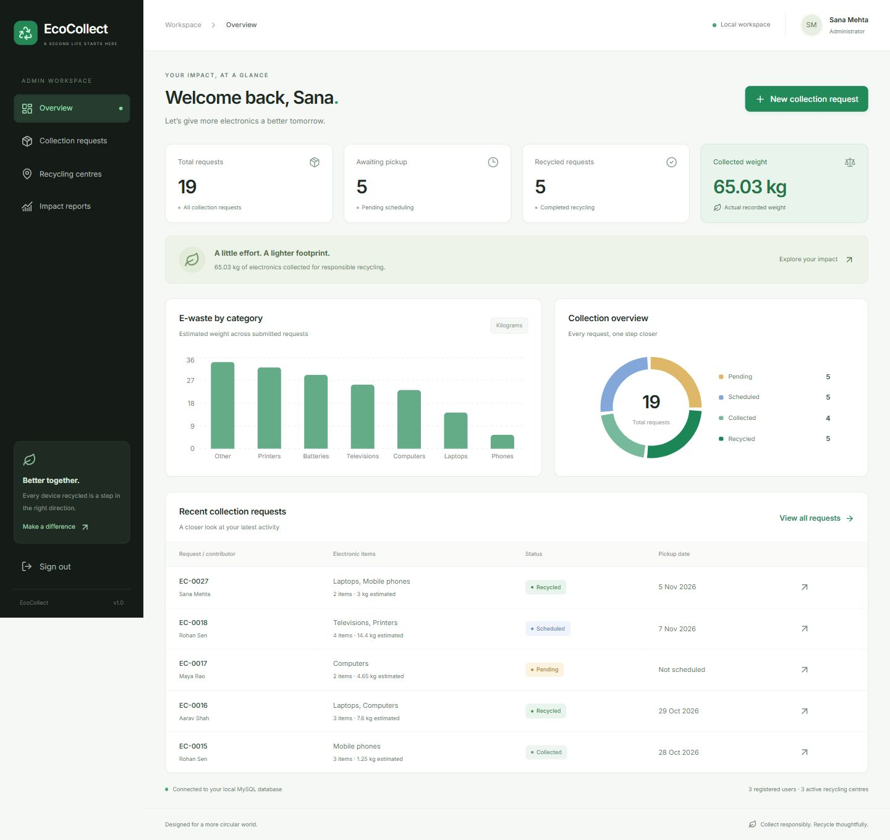
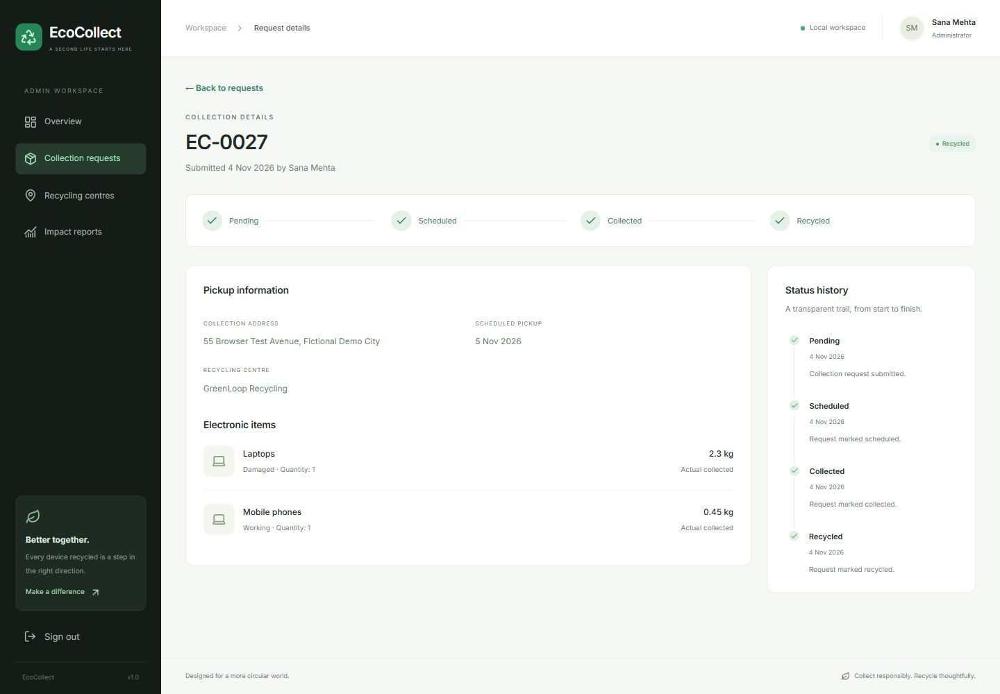
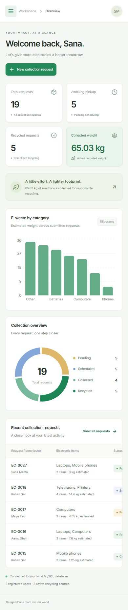

# ♻️ EcoCollect

### E-Waste Collection & Recycling Management System

EcoCollect is a full-stack web application developed as a **Database Management Systems (DBMS) mini-project**.

It provides a modern platform for registering electronic waste collection requests, managing pickups, assigning recycling centres, and tracking recycling activities.

Built with **React, FastAPI, and MySQL**, EcoCollect combines a clean, responsive interface with a relational database to demonstrate practical DBMS concepts.

## Live Application

**Deployment Status:** Planned

EcoCollect currently runs locally. Public deployment is planned using cloud hosting.

Once deployed, the application will be accessible through a web browser without requiring users to install software.

**Live Website:** Coming soon

A QR code linking to the deployed application will be added after deployment.

## Application Preview

### Admin Dashboard



### Collection Management



### Mobile Interface



## Features

### User Features

- Account registration and login.
- Electronic waste collection requests.
- Multiple items per request.
- Item categorization and condition tracking.
- Estimated weight recording.
- Collection status tracking.
- Collection history.

### Administrator Features

- Analytics dashboard.
- Collection request management.
- Pickup scheduling.
- Recycling-centre assignment.
- Collection and recycling status updates.
- Actual collected weight recording.
- Recycling-centre management.
- Database-driven reports and CSV exports.

## Technology Stack

| Layer | Technologies |
|---|---|
| Frontend | React, Vite, JavaScript |
| Styling | Tailwind CSS |
| Backend | Python, FastAPI |
| Database | MySQL |
| ORM | SQLAlchemy |
| Database Driver | PyMySQL |
| Authentication | JWT, Argon2 |
| Charts | Recharts |
| Icons | Lucide |

### Planned Cloud Infrastructure

| Component | Platform |
|---|---|
| Source Code | GitHub |
| Frontend Hosting | Cloudflare Pages |
| Backend Hosting | Render |
| MySQL Hosting | Aiven |

Cloud hosting is planned and has not yet been deployed or verified.

## System Architecture

```text
                User / Web Browser
                         |
                         v
                  React Frontend
                         |
                    REST API
                         |
                         v
                  FastAPI Backend
                         |
                    SQLAlchemy
                         |
                         v
                   MySQL Database
```

The backend manages authentication, request validation, collection workflows, and database operations.

## Database Design

EcoCollect uses six core relational tables:

1. `users`
2. `ewaste_categories`
3. `collection_requests`
4. `request_items`
5. `recycling_centres`
6. `status_history`

### DBMS Concepts Implemented

- Primary keys and foreign keys
- One-to-many relationships
- Database normalization
- Referential integrity
- SQL constraints
- CRUD operations
- Joins and aggregation
- Transactions and rollback
- Row-level locking
- Data validation

### Collection Workflow

```text
Pending
   |
   v
Scheduled
   |
   v
Collected
   |
   v
Recycled
```

Each valid status change is recorded in the database.

The ER diagram and relational schema are available in `docs/ER_DIAGRAM.md`.

## Local Development

The project can also run entirely on a local machine.

### Prerequisites

- Python 3.12 or later
- Node.js LTS
- MySQL Community Server 8.4
- Git

### 1. Clone the Repository

```bash
git clone https://github.com/YOUR-USERNAME/EcoCollect.git
cd EcoCollect
```

Replace the repository URL after publication.

### 2. Configure MySQL

Create a database and application user:

```sql
CREATE DATABASE ecocollect
CHARACTER SET utf8mb4
COLLATE utf8mb4_unicode_ci;

CREATE USER 'ecocollect'@'127.0.0.1'
IDENTIFIED BY 'your-secure-password';

GRANT ALL PRIVILEGES ON ecocollect.*
TO 'ecocollect'@'127.0.0.1';
```

### 3. Install Backend Dependencies

On Windows:

```powershell
py -3.12 -m venv .venv
.\.venv\Scripts\python.exe -m pip install -r requirements-lock.txt
```

Create the environment configuration:

```powershell
Copy-Item .env.example .env
```

Update `.env` with the MySQL connection details.

Generate a secure JWT secret:

```powershell
py -3.12 -c "import secrets; print(secrets.token_urlsafe(48))"
```

Set the generated value as `JWT_SECRET` in `.env`.

### 4. Initialize the Database

Make sure MySQL is running.

```powershell
.\.venv\Scripts\python.exe -m backend.init_db
```

Optional demonstration data:

```powershell
.\.venv\Scripts\python.exe -m backend.seed
```

Use the seed script only on a suitable fresh demonstration database.

### 5. Install Frontend Dependencies

```powershell
cd frontend
npm install
cd ..
```

### 6. Run EcoCollect

On Windows:

```powershell
.\Start-EcoCollect.cmd
```

The application launcher starts the local development services.

Open the frontend address displayed by the launcher.

For the current local configuration, the frontend uses port `5174` and the backend uses port `8001`. These may differ on another installation.

## Project Structure

```text
EcoCollect/
├── backend/                  # FastAPI application
├── frontend/                 # React frontend
├── database/                 # SQL schema and queries
├── docs/                     # Documentation and diagrams
├── scripts/                  # Utility scripts
├── tests/                    # Integration tests
├── output/                   # Generated project report
├── .env.example              # Configuration template
├── requirements.txt
├── requirements-lock.txt
├── Start-EcoCollect.cmd
├── Start-EcoCollect.ps1
└── README.md
```

## Testing

Backend integration tests:

```powershell
.\.venv\Scripts\python.exe -m pytest tests -q
```

Frontend build:

```powershell
cd frontend
npm run build
```

Integration tests require a configured MySQL database. They should be run against an appropriate development or test database.

## Project Documentation

- `docs/PROJECT_REPORT.md` — Complete project report
- `docs/ER_DIAGRAM.md` — Entity-relationship diagram
- `docs/VIVA_GUIDE.md` — Viva preparation
- `docs/TEST_RESULTS.md` — Testing documentation
- `database/schema.sql` — Database schema
- `database/queries.sql` — SQL queries

## Project Team

Developed as a group mini-project for the Database Management Systems course.

**Group Members:**

- Soumyajit Mandal
- Sourja Sinha
- Harsh Kumar Jha
- Sayandip Rout
- Aditya Chaubey

## Academic Purpose

EcoCollect is an educational prototype created to demonstrate relational database design, SQL operations, data integrity, transaction management, and full-stack application development.

It is not intended for production waste-management operations.

---

**EcoCollect — Smarter E-Waste Collection, Better Recycling.**