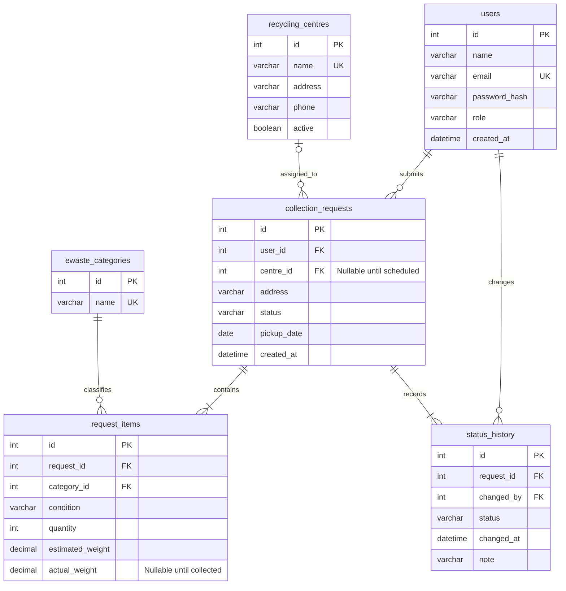

# EcoCollect entity relationship diagram

The API enforces at least one item and an initial history event per request. Foreign keys enforce that child rows have a valid parent. Item weights describe the entire row, not one unit. All timestamps are UTC; pickup dates are local calendar dates.
