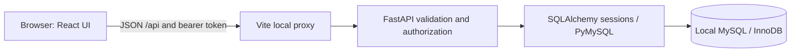
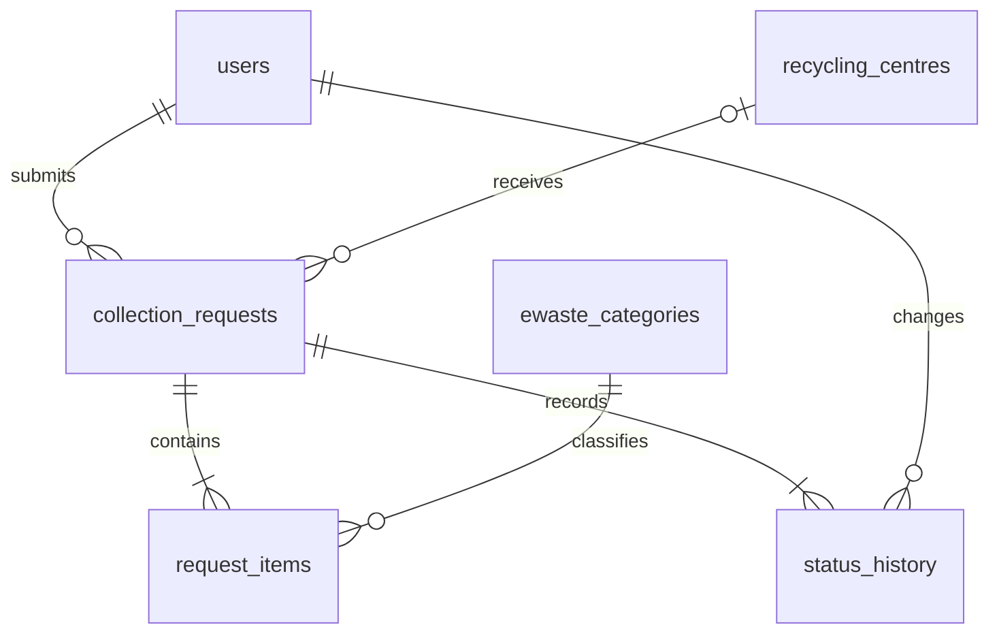

# EcoCollect
## E-Waste Collection and Recycling Management System

**DBMS Mini-Project Report**

College: [College name]  
Department: [Department]  
Course / semester: [Course and semester]  
Submitted by: [Student names and roll numbers]  
Guide: [Faculty guide]  
Academic year: [Academic year]

## 1. Abstract

Electronic waste contains recoverable materials but requires organized collection and responsible processing. EcoCollect is a local web application that registers collection requests, classifies electronic items, schedules pickups and tracks recycling. A normalized MySQL database stores users, categories, requests, item rows, recycling centres and status history. The React interface provides user and administrator workspaces, while FastAPI implements validation, authentication and database operations. SQL aggregation supplies dashboards and reports. The project demonstrates one-to-many relationships, referential integrity, CRUD operations and transaction management through a practical environmental application.

## 2. Introduction

Households and institutions accumulate obsolete phones, computers and other electronics. A structured collection system can record what is available, where it should be collected and how far it has progressed toward recycling. EcoCollect provides that workflow without depending on paid APIs, cloud hosting or complex infrastructure. It is designed for a college demonstration on a single laptop.

## 3. Problem statement

Unstructured collection records make it difficult to coordinate pickups, distinguish estimated and measured weights, assign recycling centres and produce reliable summaries. The system must preserve a clear relationship between a contributor, a collection request and its individual electronic items, while maintaining an auditable status history.

## 4. Objectives

- Register electronic waste requests containing one or more items.
- Classify items by database-managed category and condition.
- Schedule pickup dates and assign recycling centres.
- Record actual collected weights and recycling completion.
- Preserve workflow history and maintain item inventory records.
- Generate database-derived status, category and centre summaries.
- Demonstrate relational design, constraints, joins, aggregation and transactions.

## 5. Technology stack

| Layer | Technology | Purpose |
|---|---|---|
| Interface | React, JavaScript, Vite | Interactive local web application |
| Design | Tailwind CSS, custom CSS, Inter, Lucide | Responsive, accessible dashboard |
| Charts | Recharts | Category weights and request status distribution |
| API | Python, FastAPI, Pydantic | JSON endpoints and input validation |
| Persistence | SQLAlchemy, PyMySQL | Parameterized relational database operations |
| Database | MySQL Community Server 8.4, InnoDB | Constraints, relationships and transactions |
| Authentication | Argon2 via pwdlib, PyJWT | Hashed passwords and expiring bearer tokens |
| Testing | pytest, FastAPI TestClient | Real-MySQL integration tests |

Exact installed Python versions are recorded in requirements-lock.txt; frontend versions are recorded in frontend/pnpm-lock.yaml.

## 6. System architecture



The browser never receives database credentials. The server reads configuration from `.env`. All services bind to loopback. Vite serves the interface on port 5173, FastAPI runs on port 8000, and the project-owned MySQL instance uses port 3307 on this laptop. A normal installation can use port 3306 instead.

## 7. Functional requirements

Regular users register, sign in, submit requests, add multiple item rows, view their own requests and follow status history. They can delete pending requests. Administrators view all requests, search and filter them, assign centres, schedule pickup, enter actual weights and advance the workflow. Administrators also add or edit centres and view reports. Registration always creates regular users; the demo administrator is created by the seed script.

The status sequence is Pending → Scheduled → Collected → Recycled. Skipping steps or moving backward is rejected. Scheduled requests require a centre and date. Collection requires a positive actual weight for every item row. Estimated and actual weights are totals for their row, rather than per-unit weights.

## 8. Database design

The schema contains six tables. Integer surrogate primary keys identify rows. Foreign keys link users, requests, items, centres and history. Centre assignment and actual weights are nullable until the corresponding workflow stage. Email addresses, category names and centre names are unique. NOT NULL constraints protect required values. CHECK constraints restrict allowed values and positive quantities/weights. Foreign keys restrict removal of referenced users, categories and centres. Child item and history rows are removed with a deleted request.

InnoDB supports transactional operations and foreign-key enforcement. Indexes on request user, centre, status and child request IDs support common filtering and joins. For a small college dataset, no additional caching layer is needed.

## 9. ER diagram

The complete reproducible Mermaid diagram is in `docs/ER_DIAGRAM.md`. The key relationships are:



The API ensures at least one item and initial history entry per request. The database foreign keys ensure each child has a valid parent, but do not themselves enforce the minimum number of child rows.

## 10. Relational schema

| Relation | Attributes |
|---|---|
| users | **id PK**, name, **email UNIQUE**, password_hash, role, created_at |
| ewaste_categories | **id PK**, **name UNIQUE** |
| recycling_centres | **id PK**, **name UNIQUE**, address, phone, active |
| collection_requests | **id PK**, **user_id FK**, **centre_id FK**, address, status, pickup_date, created_at |
| request_items | **id PK**, **request_id FK**, **category_id FK**, condition, quantity, estimated_weight, actual_weight |
| status_history | **id PK**, **request_id FK**, status, **changed_by FK**, changed_at, note |

`database/schema.sql` contains complete MySQL DDL generated from the application models. `backend.init_db` initializes tables; `backend.seed` inserts fictional sample data in a transaction and refuses to overwrite existing users.

## 11. Normalization

**First normal form:** Each attribute holds a single value and each table has a primary key. Multiple items and status events are represented as separate rows instead of repeated columns.

**Second normal form:** Tables use single-column primary keys. Each non-key value describes the whole row, so there are no partial dependencies on part of a composite key.

**Third normal form:** User details, category labels and centre contact details live in their own relations. Requests store references rather than duplicate descriptions. Item condition and weight describe an item row, while pickup address and date describe the request.

The current status in collection_requests is a deliberate materialized snapshot of the latest history event. This is controlled redundancy for efficient workflow queries; the snapshot and event are updated in the same transaction. Dashboard totals are computed rather than stored.

## 12. Important SQL queries

The executable examples in `database/queries.sql` demonstrate INNER JOIN, LEFT JOIN, GROUP BY, HAVING, EXISTS and transaction statements.

```sql
SELECT r.id, u.name, r.status, c.name AS centre
FROM collection_requests r JOIN users u ON u.id = r.user_id
LEFT JOIN recycling_centres c ON c.id = r.centre_id;

SELECT status, COUNT(*) AS total
FROM collection_requests GROUP BY status;

SELECT c.name, SUM(i.quantity) AS units,
       COALESCE(SUM(i.actual_weight), 0) AS collected_kg
FROM ewaste_categories c JOIN request_items i ON c.id = i.category_id
GROUP BY c.id, c.name;
```

Centre reports pre-aggregate weights per request before joining to centres. This avoids multiplying request counts when a request has multiple item rows. Missing actual weights do not contribute to measured collection totals.

## 13. Transaction management

Creating a request adds its parent, all item rows and the initial history event in one SQLAlchemy transaction. A workflow update locks the request with SELECT FOR UPDATE, checks the next allowed status, changes the request and appends history, then commits. Any exception rolls back the active session transaction. A failed commit must not leave a new status without its matching history event.

**Atomicity:** Related changes commit together. **Consistency:** Foreign keys, checks and application validations protect rules. **Isolation:** InnoDB transactions and row locks coordinate concurrent workflow updates. **Durability:** MySQL persists successful commits to disk. The integration suite injects a commit failure to verify rollback behavior.

## 14. Implementation overview

The backend separates configuration, SQLAlchemy models, Pydantic input schemas, authentication, collection requests and report aggregation. FastAPI endpoints return JSON with meaningful HTTP status codes: 401 for missing/invalid login, 403 for missing admin permissions, 404 for missing or inaccessible requests, 409 for conflicts and invalid transitions, and 422 for validation failures. Database unavailability returns a helpful 503 response.

The frontend contains authentication, dashboard, collection list, new request, request detail, centre management and report screens. Shared components implement branding, request tables, status badges, statistics, charts, error messages and loading states. Charcoal navigation, muted mint backgrounds, green actions and clear typography follow the supplied reference without adding unrelated payment or rewards features.

Passwords use Argon2 hashing. JWTs expire after eight hours and are stored in browser session storage. Every protected request looks up the database user and enforces ownership or administrator role. Source-controlled examples contain no database password. The app is intended for local use; internet-facing hardening such as HTTPS and rate limiting is not implemented.

## 15. Application screenshots

Actual browser screenshots are stored in `docs/screenshots/dashboard.png`, `docs/screenshots/completed-request.png` and `docs/screenshots/mobile-dashboard.png`. The administrator overview, complete recycling timeline and responsive mobile view were captured from the running local application. The PDF includes the overview in an appendix.

## 16. Testing results

On 4 November 2026, all six real-MySQL integration tests passed. They cover registration, user/admin login, access isolation, multi-item insertion, persistence, scheduling, workflow transitions, actual weights, history, aggregates, foreign keys, CHECK constraints, deletion and rollback. Frontend production compilation and live API startup also passed. A browser-created two-item request completed the full workflow and increased actual collected weight from 62.28 kg to 65.03 kg; the exported CSV matched these totals. Desktop and mobile layouts were inspected. See `docs/TEST_RESULTS.md` for detailed evidence and verification limits. Load testing, production security auditing and Linux execution were not performed.

## 17. Conclusion

EcoCollect applies relational database principles to a complete electronic-waste collection workflow. The system connects contributions, items, centres and history with clear relationships and produces useful summaries from stored records. Its small local architecture supports demonstration, inspection and explanation in a DBMS laboratory setting.

## 18. Future scope

Potential extensions include optional map-based centre discovery, request rescheduling, staff pickup assignments, report date filters and stronger production authentication controls. These are intentionally outside the current mini-project. The map locator listed as extra technology in the assignment is omitted according to the detailed project prompt.

## 19. References

- Supplied assignment: DBMS MINI project requirement.pdf, E-Waste Collection and Recycling Management System.
- FastAPI authentication: https://fastapi.tiangolo.com/tutorial/security/oauth2-jwt/
- SQLAlchemy 2.0 documentation: https://docs.sqlalchemy.org/en/20/
- MySQL 8.4 reference manual: https://dev.mysql.com/doc/refman/8.4/en/
- Tailwind with Vite: https://tailwindcss.com/docs/installation/using-vite
- React documentation: https://react.dev/
- Recharts documentation: https://recharts.github.io/
